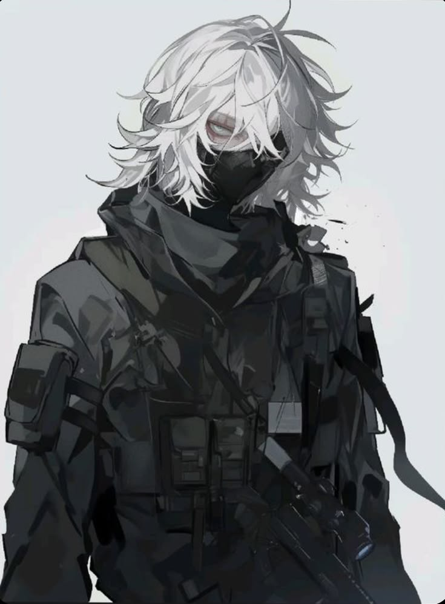

<a href="./general-ramcher" class="featured-card">GGeneral RamcherCommander of Anajak Forces</a><a href="./nogo" class="featured-card">NNogoDraftAnajak Forces assassin</a><a href="./pepper" class="featured-card">PPepperDraftAnajak Forces operator; adjutant to the president of VISTA</a><a href="./tanishito" class="featured-card">TanishitoDraftAnajak Forces assassin</a><a href="./tarnished" class="featured-card">TTarnishedFormer ITF special task force leader, volunteer of Anajak Forces</a><a href="./verdanski" class="featured-card">VVerdanskiA+ facility-trained member of Anajak Forces</a>
