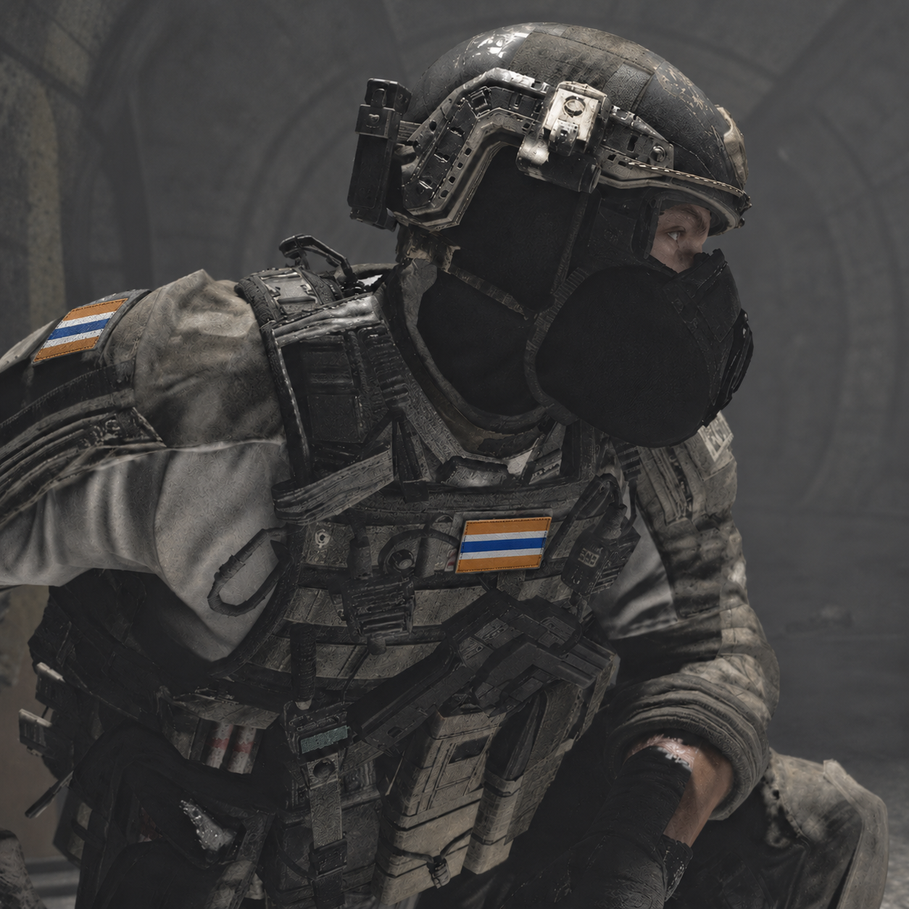

<aside class="custom-infobox infobox-character">
<h3>Andrew</h3>

<table>
<tr><th>Title</th><td>Andrew</td></tr>
<tr><th>Subtitle</th><td>Assaulter of LENDERMAIRE</td></tr>
<tr><th>Unit</th><td>LENDERMAIRE</td></tr>
<tr><th>Former Unit</th><td>Ironish Special Forces</td></tr>
</table>
</aside>

# Andrew

**Andrew** is the assaulter of the black operations unit [[LENDERMAIRE]]. He is a former squad member of the Ironish Special Forces, together with [[Markless]] and [[Kaliber]], and has been in LENDERMAIRE since its early development.

He is the only member of the household whose place in it is contested. Where he sits on the thirteen-member roster is unconfirmed: he is not among the twelve members named earlier, and the record leaves his place unresolved. He is also the only member recorded as having come to the household for someone else.

## 1. The squad

Andrew served in the Ironish Special Forces alongside [[Markless]] and [[Kaliber]]. All three left that unit and all three are recorded in LENDERMAIRE from its early development.

Kaliber and Markless are counted among the core membership. Andrew is not. The record does not establish why his place remains contested while theirs do not.

He is recorded as having come to the household on account of his squadmates rather than on his own account. The record does not describe his own circumstances at the time, and does not establish whether he was cast off, dismissed, or had anywhere else to go.

## 2. The contested seat

His position among the thirteen has never been settled in the record, and three readings remain open: that the household has not finished accepting him, that he has not finished accepting the household, or that something occurred which the record does not describe and which nobody in the household discusses.

None of the three is confirmed. The record does not indicate which is true, or whether more than one has been true at different times.

## 3. The conditioning

Andrew is recorded as knowing what [[Konish Kimbotin (Reimagined)|Konish Kimbotin]] does to the members of the household, and as understanding it.

Konish is recorded as having convinced him. The record does not state what was said, or what argument was made. This is the only instance in which Konish is recorded as having argued for a member rather than simply selecting one, and the content of that argument is not established.

Whether Andrew is subject to the conditioning the rest of the household is held by is not stated.

## 4. The chair

In the household, Andrew is recorded as taking the chair by the door. The household reads this as uncertainty about whether he is permitted to remain.

The position is also the seat nearest the exit, and the seat nearest his two former squadmates. The record does not establish which of these readings is correct.

## Unresolved

- **Place among the thirteen:** Whether Andrew sits among the thirteen core members. He is not among the twelve named earlier, and his place is unconfirmed.
- **What Konish said:** The argument that convinced him is not recorded, and it is the only recorded instance of Konish arguing for a member.
- **The loyalty:** Andrew's loyalty is recorded as running through his squadmates rather than directly to Konish. The household is not recorded as knowing this. Konish is. Andrew knows that Konish knows.
- **The conditioning:** Whether he is held by the same mechanism as the twelve is not stated.
- **His own account:** Why he came, and what he left, are not established.
## See Also

* [[LENDERMAIRE]]
* [[Markless]]
* [[Kaliber]]
* [[Ironish Task Force (ITF)]]
