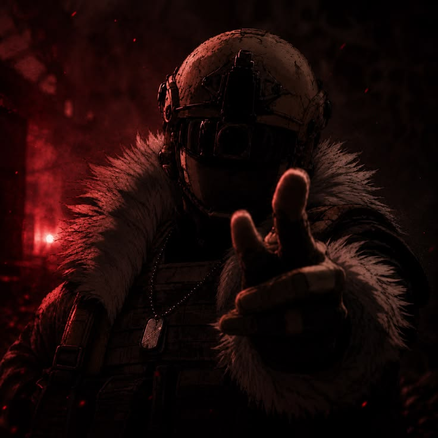
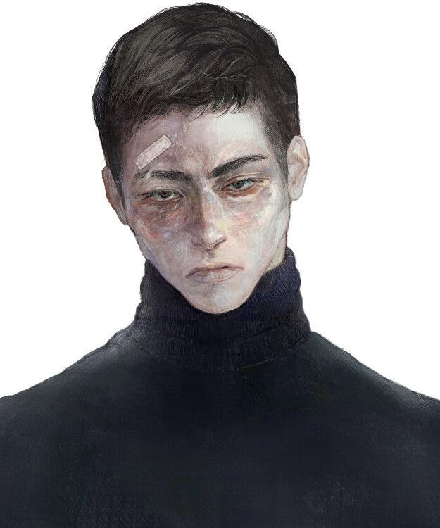

<h1 class="hero-title">NOLHEIM</h1>
The Independent Encyclopedia of Parialfare: Reimagined

The year is 2008. The world is dominated by a technology race and an information war, fought through covert operations, contractors, and black-site facilities rather than open conventional war. The most powerful figures in the region are not states, but warlords, intelligence agencies, and private military companies.

<h2 class="home-section-title">Featured Records</h2>
<a href="characters/lendermaire/konish-kimbotin-(reimagined)" class="featured-card">
<h3>Konish Kimbotin</h3>
Supreme Warlord of the Cladish insurgency.

</a><a href="characters/lendermaire/samsara-lykor" class="featured-card">
<h3>Samsara Lykor</h3>
The concealed thirteenth member of LENDERMAIRE.

</a><a href="events/2008-pocheasang-palace-raid" class="featured-card">
<h3>2008 Pocheasang Palace Raid</h3>
The foundational act of the modern insurgency.

</a>
<h2 class="home-section-title">Explore the Archive</h2>
<a href="portal---characters" class="portal-button">01. Personnel</a><a href="portal---factions" class="portal-button">02. Organizations</a><a href="portal---locations" class="portal-button">03. Geography</a><a href="portal---events" class="portal-button">04. Historical Log</a><a href="portal---lore" class="portal-button">05. Systems & Lore</a>
